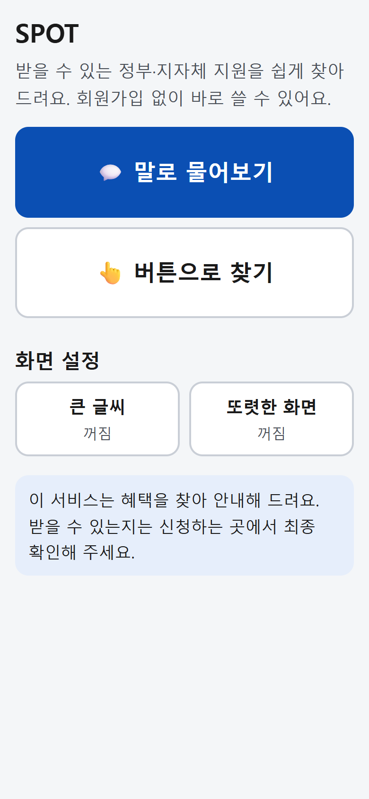
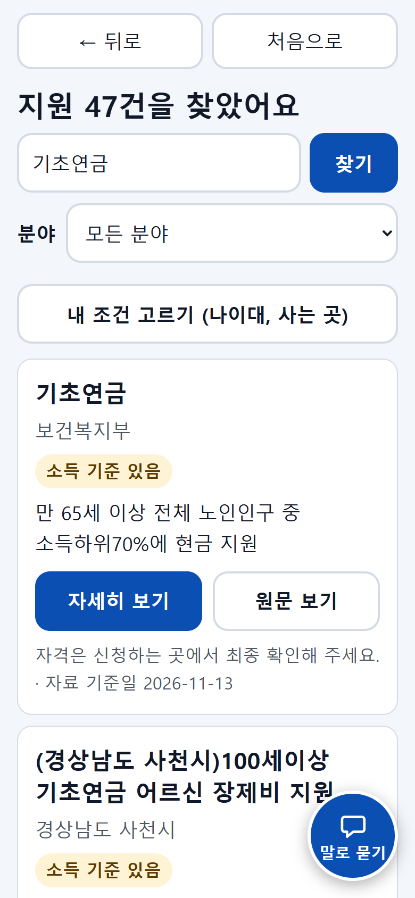
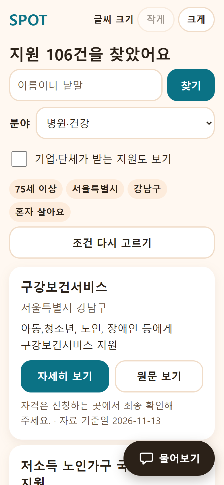
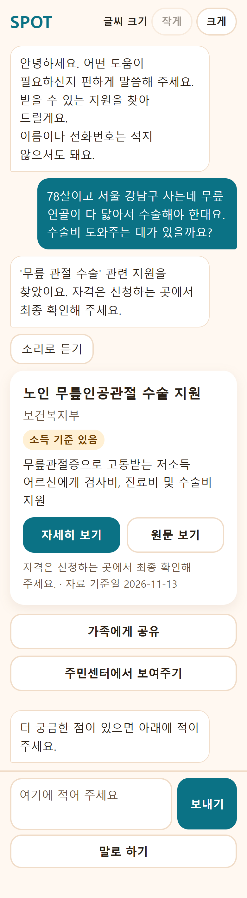
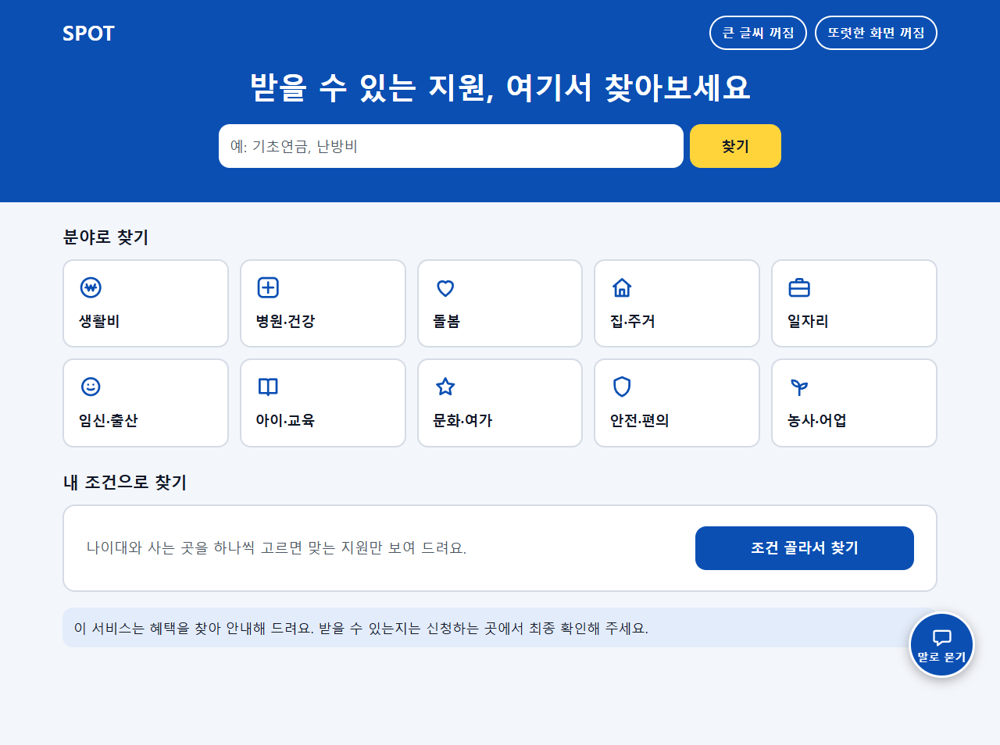
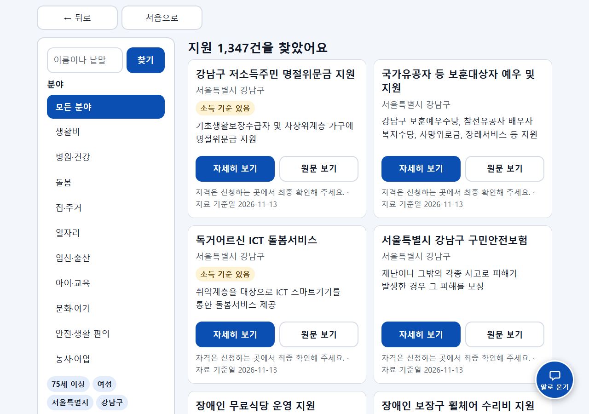

# SPOT

받을 수 있는 정부·지자체 지원 정책을 찾아 주는 모바일 웹앱입니다. 찾는 방법은 네 가지입니다.

- **이름이나 낱말로 찾기**: 검색창에 "기초연금", "난방비"처럼 적습니다.
- **분야로 찾기**: 생활비, 병원·건강, 돌봄 등 10가지 분야 버튼을 누릅니다.
- **내 조건으로 찾기**: 나이대, 성별, 사는 곳, 가구 형태를 하나씩 고릅니다.
- **말로 묻기**: 모든 화면 오른쪽 아래의 버튼을 눌러 평소 말투로 상황을 이야기하면 AI가 맞는 지원을 골라 줍니다.

앞의 세 가지는 AI를 쓰지 않아서 AI 무료 한도와 상관없이 항상 동작하고, 결과 화면에서 서로 겹쳐 좁힐 수 있습니다.

자세한 요구사항과 구조는 [PROJECT_SPEC.md](PROJECT_SPEC.md)에 있습니다.

## 현재 진행 상황

- [x] 1주차 1단계: 프로젝트 뼈대
- [x] 1주차 2단계: 테이블 생성 SQL 작성 (`scripts/init_db.sql`), Neon에 테이블 생성
- [x] 1주차 3단계: 공공데이터 API 응답 확인, 지원조건 코드 매핑표 (`data/condition_codes.json`)
- [x] 1주차 4단계: 수집 스크립트 (`scripts/ingest.py`)
- [x] 1주차 5단계: 지역 코드 (`scripts/load_regions.py`, `data/regions.csv`)
- [x] 1주차 6단계: 조회 API (`/api/search`, `/api/policy/{id}`, `/api/policies`, `/api/options`, `/api/regions`, `/api/health`)
- [x] 1주차 7단계: Render 첫 배포 (`/api/health` 확인 완료)
- [x] 2주차 1단계: 임베딩(`embedder.py`), 조건 필터 + 의미 검색(`retriever.py`의 `search_semantic`)
- [x] 2주차 2단계: Groq 연결(`llm.py`), 질문 분석(`analyzer.py`, `prompts/analyze.txt`, `data/keywords.json`)
- [x] 2주차 3단계: 되묻기 흐름 (`POST /api/chat`, 답변 생성은 3주차)
- [x] 2주차 4단계: 개인정보 가리기 (`privacy.py`) + 테스트
- [x] 2주차 5단계: 시나리오 질문 30개 (`data/scenarios.json`)
- [x] 2주차 6단계: 검색 평가 스크립트 (`scripts/eval_scenarios.py --no-llm`) — 30개 중 26개(87%), 거리 기준값 0.15로 결정
- [x] 2주차 7단계: 공통 CSS, 버튼 조회 화면(`search.html`), 정책 상세 화면(`policy.html`)
- [x] 3주차 1단계: 답변 생성(`answerer.py`), fallback 처리, 사용량 제한(`rate_limit.py`)
- [x] 3주차 2단계: 나머지 화면 (시작, 채팅, 공유, 주민센터에서 보여주기, 큰 글씨·고대비 모드)
- [x] 3주차 3단계: PWA 설정 (홈 화면에 추가, 아이콘)
- [x] 3주차 4단계: Render 최종 배포 확인 (휴대폰에서 질문 → 되묻기 → 결과 → 공유 확인)
- [x] 4주차 1단계: 시나리오 30개 답변 평가 (`python scripts/eval_scenarios.py`) — 30개 중 25개(83%) 적합, 목록 밖 정책 언급 0건 (2026-11-14)
- [x] 4주차 2단계: 평가 결과로 프롬프트·키워드 규칙·모델 조정 (검색 보완: 제도 낱말, 일상 표현 규칙, 아이를 위한 질문 처리) — 다시 평가: 30개 중 28개(93%) 적합, 지어낸 정책 언급 0건. 규칙을 만들 때 보지 않은 새 질문 12개는 검색 기준 9개(75%)
  - 2026-11-15에 코드를 바꾸지 않고 전체를 다시 평가: 30개 중 30개(100%) 적합, 사용자에게 나간 목록 밖 정책 언급 0건. AI가 고르는 정책이 돌릴 때마다 조금씩 달라서 93~100%로 본다
- [ ] 4주차 3단계: 사용자 테스트 (60대 이상 포함), 설문 — 진행 순서와 설문지는 준비됨 ([docs/user_test.md](docs/user_test.md)). 테스트는 아직 하지 않음
- [x] 4주차 4단계: README 정리, 발표 자료용 스크린샷 ([docs/screenshots/](docs/screenshots/))
- [x] 화면 구성 변경 (2026-11-15): 직접 찾기(낱말 검색, 분야 버튼, 조건 고르기)를 첫 화면으로 올리고, 채팅은 모든 화면 오른쪽 아래의 [말로 묻기] 버튼으로 옮김
- [x] 화면 디자인 변경 (2026-11-15): 시안 세 가지 중 "또렷한 파랑"으로 정해 반영. 컴퓨터(폭 900px 이상)에서는 같은 내용을 넓게 배치하고, [말로 묻기]는 작은 채팅 창으로 뜸

## 성과 목표 확인

명세서 13장의 목표 다섯 가지를 확인한 결과입니다.

| 지표 | 목표 | 결과 | 확인한 방법 |
|---|---|---|---|
| 새로 알게 된 혜택 수 | 참가자 1인당 1개 이상 | 아직 확인 못 함 | 사용자 테스트 설문 ([docs/user_test.md](docs/user_test.md)) |
| 사용 편의성 | 60대 이상 평균 4점 이상 | 아직 확인 못 함 | 사용자 테스트 설문 |
| 조회 정확도 | 조건 부합 90% 이상 | 100건 중 부합 93건, 애매 5건, 불일치 2건 (93~98%) | 조건 5세트 × 20건을 원문과 대조 ([docs/search_accuracy.md](docs/search_accuracy.md), 2026-11-15) |
| 검색 품질 | 80% 이상 | 30개 중 30개 (100%) | `python scripts/eval_scenarios.py --no-llm` (2026-11-15) |
| 채팅 답변 정확도 | 적합 80% 이상, 없는 정책 언급 0건 | 30개 중 28~30개 (93~100%), 0건 | `python scripts/eval_scenarios.py` (2026-11-14, 11-15) |

숫자를 읽을 때 주의할 점:

- 시나리오 30개는 놓친 것을 보고 규칙을 고친 질문들이라 실제보다 좋게 나옵니다. 규칙을 만들 때 보지 않은 새 질문 12개는 검색 기준 9개(75%)였고, 실제 사용에서는 이쪽에 가까울 것으로 봅니다.
- 채팅 답변 평가는 "기대한 정책이 답변에 들어갔는가"만 자동으로 셉니다. 함께 나온 다른 정책이 상황에 맞는지는 사람이 읽어 봐야 합니다.
- 조회 정확도는 AI가 원문을 읽고 판정했습니다. "조건에 어긋나는 정책이 섞이지 않았는가"만 보며, 그 사람에게 쓸모 있는 정책인지는 보지 않습니다.

## 화면

| 시작 | 낱말로 찾은 결과 | 조건과 분야로 좁힌 결과 | 채팅 결과 |
|---|---|---|---|
|  |  |  |  |

조건 고르기, 채팅 되묻기, 정책 상세, 공유 화면, 주민센터에서 보여주기, 큰 글씨·또렷한 화면 등 나머지 화면은 [docs/screenshots/](docs/screenshots/)에 있습니다 (휴대폰 크기 390×844, 2026-11-15에 내 컴퓨터에서 실행해 찍음).

컴퓨터에서는 같은 주소가 넓은 배치로 보입니다 (20~22번 스크린샷, 폭 1280px).

| 컴퓨터 시작 화면 | 컴퓨터 결과 화면 |
|---|---|
|  |  |

## 준비물 (모두 무료)

| 무엇 | 어디서 | `.env`에 넣을 이름 |
|---|---|---|
| 공공데이터포털 인증키 | data.go.kr → 「행정안전부_대한민국 공공서비스(혜택) 정보」 활용신청 | `DATA_GO_KR_API_KEY` |
| Neon DB 연결 문자열 | neon.tech → 프로젝트 만들기 → Connection string | `DATABASE_URL` |
| Groq API 키 | console.groq.com → API Keys | `GROQ_API_KEY` |

## 내 컴퓨터에서 실행하기 (Windows PowerShell)

```powershell
# 1. 가상환경 만들기 (처음 한 번)
python -m venv .venv
.venv\Scripts\Activate.ps1

# 2. 패키지 설치 (처음 한 번, 몇 분 걸림)
pip install -r requirements.txt

# 3. 환경변수 파일 만들기 (처음 한 번) → 메모장으로 .env 를 열어 값 채우기
Copy-Item .env.example .env

# 4. 서버 실행
uvicorn app.main:app --reload --port 7860
```

브라우저에서 http://localhost:7860 을 엽니다.

## DB 테이블 만들기

Neon 콘솔의 **SQL Editor**에 `scripts/init_db.sql` 내용을 붙여 넣고 실행합니다. 여러 번 실행해도 괜찮습니다.

## 정책 데이터 넣기

```powershell
# 1. 공공데이터 API에서 받아서 → 정리 → 임베딩 → DB 저장 (10~20분)
python scripts/ingest.py

# 2. 지역 코드표 갱신 후 DB에 넣기 (지역 이름이 바뀌었을 때만 --build)
python scripts/load_regions.py --build
python scripts/load_regions.py
```

- 받은 원본은 `data/raw/`에 남습니다. 정리 규칙만 고쳤을 때는 API를 다시 부르지 않고
  `python scripts/ingest.py --from-raw --no-embed` 로 빠르게 다시 만들 수 있습니다.
- `python scripts/ingest.py --from-raw --dry-run` 은 DB에 쓰지 않고 통계만 보여 줍니다.
- 지역 코드는 법정동 코드가 아니라 이 프로젝트에서 붙인 번호입니다 (시·도 2자리, 시·군·구 5자리).

## 배포하기 (Render 무료 웹 서비스)

1. 이 폴더를 GitHub 저장소에 올립니다.
2. render.com → **New → Web Service** → GitHub 저장소 연결 → Language **Docker**, Instance Type **Free**.
3. **Environment**에 `DATABASE_URL`과 `GROQ_API_KEY`를 넣습니다. Health Check Path는 `/api/health`.
4. 배포가 끝나면 `https://<서비스이름>.onrender.com/api/health` 가 `ok`를 돌려주는지 확인합니다.

- GitHub에 올릴(push) 때마다 자동으로 다시 배포됩니다.
- 무료 서비스는 15분쯤 접속이 없으면 잠들고, 깨어나는 데 1분쯤 걸립니다. **시연 전에 미리 접속해 둡니다.**

## 홈 화면에 추가 (앱처럼 쓰기)

- 안드로이드(Chrome): 사이트를 열고 오른쪽 위 메뉴(⋮) → **홈 화면에 추가** (또는 **앱 설치**)
- 아이폰(Safari): 아래 공유 버튼 → **홈 화면에 추가**

화면 파일(`web/`)을 고쳐서 다시 배포할 때는 `web/service-worker.js` 맨 위의 `spot-v5` 숫자를 올립니다.
화면은 항상 새 것을 먼저 받아 오므로 올리지 않아도 동작하지만, 숫자를 올리면 휴대폰에 남은 옛 캐시가 지워집니다.

## 검색 평가

```powershell
# 답변까지 평가: 분석 → 검색 → 답변 생성 → 검증 (12분쯤 걸림, Groq 한도를 많이 쓰므로 하루 1~2번만)
python scripts/eval_scenarios.py

# Groq를 쓰지 않고 검색만 평가 (몇 번이든 돌려도 됨)
python scripts/eval_scenarios.py --no-llm

# 실제 채팅처럼 질문 분석(작은 모델)을 거쳐서 평가 (5분쯤 걸림, Groq 한도 사용)
python scripts/eval_scenarios.py --no-llm --analyze
```

시나리오 30개(`data/scenarios.json`)의 기대 정책이 후보 8개 안에 드는 비율과 거리 분포를 보여 줍니다.

## 조회 정확도 확인

```powershell
# 조건 5세트로 버튼 조회를 하고 세트마다 20건을 뽑아 원문과 함께 출력 (Groq를 쓰지 않음)
python scripts/sample_search.py
```

뽑힌 정책의 지원 대상·선정 기준을 읽고 나이·지역·성별 조건에 맞는지 대조합니다. 대조한 결과는 [docs/search_accuracy.md](docs/search_accuracy.md)에 있습니다.

## 사용자 테스트

진행 순서, 관찰 기록표, 인쇄해서 쓰는 설문지가 [docs/user_test.md](docs/user_test.md)에 있습니다.
테스트하는 날에는 Groq 한도를 아끼기 위해 답변 평가(`eval_scenarios.py`)를 돌리지 않습니다.

## 테스트

```powershell
python -m pytest -q
```

## 주의

- `.env` 파일은 절대 GitHub에 올리지 않습니다 (`.gitignore`에 들어 있음).
- 사용자의 대화 내용은 어디에도 저장하지 않습니다.
